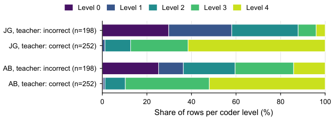

# A.4 Methods, prompts, conditions and uncertainty

[Appendix index](README.md)

[A.4.1 Inherited components and interfaces](04-methods.md#a41) · [A.4.2 Data, sampling, and grading](04-methods.md#a42) · [A.4.3 Independent human reference](04-methods.md#a43) · [A.4.4 Score-blind rationale instruments](04-methods.md#a44) · [A.4.5 Models, prompts, and deployment conditions](04-methods.md#a45) · [A.4.6 Measurement definitions and analysis protocol](04-methods.md#a46)

## A.4.1 Inherited components and interfaces

This section describes how the architecture of Section 3.2 of the article and its extensions (Section 3.3 of the article) were instantiated for the experiments of this article. The component description reuses the text of Section 3 of the ICWE paper [\[10\]](references.md#ref-Gwozdz2026ICWE) where it still applies and states what differs in this article.

Figure 1 of the article shows the architecture and interaction boundaries. In the experiments of this article, the input is a frozen pool of stored responses instead of live submissions from the assessment interface. The grading service builds a request from the target answer and the teacher-rated examples that the fold-wise protocol selects for the configured example count (Section 4.4), then invokes the configured backend through the model adapter: a vLLM server on a university GPU host for the locally served open-weight models, or the OpenRouter API for the hosted models. The returned output is stored together with the raw response; in this retrospective setting no teacher reviews the outputs, and neither coder of the human reference sees them (Section 4.2). The in-context examples keep their historical teacher labels; the independent raw codings, the pre-adjudication agreement report, and the adjudicated reference are separate data stages, and none of them is written back to the example pool.

The evaluation and analytics module computes the comparisons of this article offline, after all outputs of a condition have been collected; it does not run as a continuous operational pipeline. A cross-cutting logging and traceability layer records for each target grading evaluation the question, the fold, the requested and the actual number of in-context examples, the parsed decision and confidence, the parse outcome, the number of attempts and retries, the failure and finish reasons, the token usage and billed cost, and the final raw response. A run manifest pins the hash of the source data, the model identifier, the effective request settings and, for every run except the four original on-premises base runs, the hash of the system prompt. These records support auditability, failure diagnosis, and post-hoc reproducibility. Where a record is incomplete, the affected values are marked rather than reconstructed (Section 6.3 of the article).

The inherited interface contract is reused for binary grading and extended for the new output fields. The grading service consumes the question text, the teacher-rated examples, and the target answer and produces a JSON object whose keys depend on the condition: `correct` and `confidence` in the base condition, an additional `reason` in the rationale condition, and `correct`, an integer `level` from 0 to 2, and `confidence` in the partial-credit condition. The decision component of Section 4.4 satisfies the same input contract but returns typed decisions instead of generated JSON, and the rationale judges are separate components with their own contract: they consume only a rationale and return a category with an evidence quote.

Similarly, the feedback store and analytics module can be replaced independently as long as they preserve the event schema for teacher validation, prompt versioning, and prediction outcomes. This article does not replace either of them; the substitutions it evaluates all sit behind the model adapter.

## A.4.2 Data, sampling, and grading

The underlying formative assessment contains 25 items (16 multiple-choice and 9 short-answer items). As in both predecessor studies, only the nine short-answer items are analyzed, because the multiple-choice items are scored deterministically and offer no grading decision to compare [\[10\]](references.md#ref-Gwozdz2026ICWE), [\[9\]](references.md#ref-Gwozdz2026ICALT).

The nine questions cover staging changes with `git add`, the effect of a `.gitignore` file, the difference between `fetch` and `pull`, restoring a deleted branch from the reflog, conflict markers, a clone, branch, commit and push sequence, the difference between an interactive rebase and a merge without fast-forward, locating a faulty commit with `git bisect`, and tagging a release.

All analyses reuse the response pool of the ICWE study without resampling. Rows without a complete triple are excluded. To avoid duplicated observations, we deduplicate responses by question ID, question text, user ID, and answer text. In that study, a question is eligible if at least 50 teacher-rated responses are available. From each eligible question, we sampled exactly 50 rated responses without replacement using a fixed random seed. This yields nine questions and 450 target rows per grading condition, of which the teacher label marks 252 (56.0%) as correct. Because several students gave identical answers to one question (r1q21), the 450 rows contain 439 unique question–answer texts; r1q21 contributes 50 rows but 39 texts, and all other questions contribute 50 of each. Neither number is the number of distinct students.

The binary *teacher label* of a row is the decision of the course’s operational, LLM-based auto-grader, kept where the lecturer confirmed it and inverted where the lecturer overruled it; only responses that the auto-grader had scored and the lecturer had reviewed enter the pool. On the 450 rows, the lecturer confirmed the auto-grader 407 times and overruled it 43 times (9.56%). Agreement with this lecturer-reviewed operational label is therefore partly agreement with the incumbent grader; the ICALT study, which used review exports of the same course, accordingly treated its reference as a pragmatic baseline rather than blinded grading from scratch [\[9\]](references.md#ref-Gwozdz2026ICALT), and this article adds the independent reference of Section 4.2 beside the teacher label.

Each target response is identified by question, student, and answer text; its grading records, each stored with the parsed output and the raw response, are additionally distinguished by run, model, example count, fold, and repeat, and each record keeps the number of request attempts. The raw codes of the two coders are stored once per unique pair of question and exact answer text, keyed by the SHA-256 hash of the text, and broadcast to every model row that shares the text; in the comparison of binary runs with the reference, 14 model prediction artifacts from eight later runs stored their answer texts with different line endings and are joined on line-ending-normalized text, and no other normalization is applied. Missing outputs, unparseable outputs, and abstentions are separate states that are never dropped silently, and agreement with the teacher label is computed on parseable rows only. For an output that fails, the pipeline stores a technical fallback score of zero next to the failure reason. The post hoc comparison of binary runs with the binarized reference reads this stored score and therefore counts the fallback zeros as decisions of “incorrect”: this concerns six of the 450 rows of Qwen3.8 Flash, the only base arm with failed outputs at 40 examples, and two and one rows of two further runs of the selection (a Qwen3.8-27B deconfounding run and the Phi-4 rationale run). Four of the six affected Qwen3.8 Flash rows carry the teacher label incorrect, so the fallback zeros count as agreement there; the kappa values of these three runs against the reference and the teacher label include the fallback zeros.

In-context examples of a target response are drawn from the 40 responses to the same question that lie outside the target’s ten-response test fold, following the fold-wise protocol of the ICWE paper (Section 4.4). At 40 examples, the ten test rows of one question and fold share the same example set, so the 450 rows form 45 clusters of ten rows each. The target response itself is never an example, but an identical answer text from another student can be: this affects 4, 13, and 13 rows at 5, 20, and 40 examples. Agreement with the teacher label is therefore agreement on held-out responses of the same course, questions and teacher, not agreement on new questions.

## A.4.3 Independent human reference

The independent reference was built for the 439 unique question–answer texts of the pool (Section 4.1), following R2. Both authors coded all 439 texts independently with a dedicated coding tool that shows the question and the student answer and nothing else. The operational grader’s score, the lecturer’s verdict, and the grader’s feedback text are not merely hidden but absent from the data file that the tool reads, and the coding tool supplied no output of any grading condition; the two coders agreed not to inspect each other’s codes or notes before both had finished.

The coding is therefore model-blind and blind to the historical decision, but not naive: the predecessor studies [\[10\]](references.md#ref-Gwozdz2026ICWE), [\[9\]](references.md#ref-Gwozdz2026ICALT) used responses and model outputs from this course. Both authors disclose prior exposure to these materials; the second author taught the course. The records of the historical review do not identify the reviewer, so an overlap between the historical review and the new reference cannot be excluded. The tool presents the texts question by question, in a random order within each question that is derived from the data alone, so both coders saw the same sequence; identical answer texts are coded once.

The coders used the five-level scale of a coding handbook that was fixed before coding began. Its levels are defined semantically rather than as percentages: 4, fully correct, everything the question asks for is present and nothing stated is wrong; 3, correct core but incomplete, a required part is missing or too vague and nothing stated is wrong; 2, half correct, about half of what is required is present, or the core is right but a factual error stands next to it; 1, correct fragments about the asked subject that do not answer the question; and 0, nothing correct about the question, including empty and off-topic answers. Each boundary between adjacent levels is decided by one yes-or-no question, for example “Is anything missing that the question explicitly asks for?” between levels 4 and 3, and a wrong statement weighs more than an omission; the handbook illustrates the levels with answers from a different course, so that no text of the pool was graded in advance. Every saved code, note, and retraction is appended to the coder’s file, and the files are never rewritten. For the analysis, the raw scale is mapped to three levels with the fixed mapping $`0 \mapsto 0`$, $`\{1, 2, 3\} \mapsto 1`$, and $`4 \mapsto 2`$, which separates answers without credit, with partial credit, and with full credit and matches the three-level output of the partial-credit grading condition. The five-level and the three-level views are different scales and are always reported separately.

Once both coders had coded all 439 texts, the agreement between the two independent codings was computed on both scales and archived once, together with the hashes of both raw files and of the pool, before any disagreement was discussed. The tool refuses to overwrite this report, and the canonical adjudication import and the partial-credit model analysis recompute the agreement from the raw files and stop unless it matches the archive exactly; Section 5.3 reports this agreement before discussion. The two codings differed on 223 of the 439 texts: by four levels on 3 texts, by three levels on 12, by two levels on 56, and by one level on 152.

In a joint session on 12 October 2026, the two coders adjudicated all 71 texts whose codes differed by two or more levels. For each case, the adjudication view showed the question, the full answer, both raw codes, and the scale of the handbook, and the cases were taken in order of decreasing distance. The coders discussed each case and agreed on one level, which was recorded in a separate append-only adjudication file that keeps both original codes; the raw files of the coders were not changed. The agreed level was the first author’s code in 18 cases, the second author’s code in 17, and a level between the two in 36. The 152 texts with a distance of one level were not adjudicated and are retained as residual dissent. Of these, 75 lie inside the partial-credit band (20 between levels 1 and 2, and 55 between levels 2 and 3), so both codes map to partial credit and the three-level reference is unambiguous; the other 77 straddle a class boundary, 71 between levels 3 and 4 and 6 between levels 0 and 1. The resulting reference is therefore adjudicated for distances of two or more levels, with adjacent disagreements retained as residual dissent. On the three-level scale, it consists of 216 texts on which the coders agreed, 71 adjudicated texts, 75 texts with residual dissent inside the partial-credit band, and 77 boundary cases. No output of the grading conditions evaluated in this article was shown during coding or adjudication, and the reference is never used as an in-context example.

The 77 boundary cases need a rule, because the mean of the two codes (3.5 or 0.5) lies exactly on a class boundary. Rounding all 77 means down or up would uniformly assign them to the stricter or to the more lenient class and thus systematically favor one reading of the scale; it would not favor one coder, because the lower code comes from the second author in 44 of these cases and from the first author in 33. Instead, each boundary case enters every three-level comparison twice, with weight one half for each coder’s class; this soft reference is the categorical form of the mean and needs no rounding rule. Three variants serve as sensitivity analyses: *strict* assigns all boundary cases to the lower class, *lenient* to the higher class, and *exclude boundary* removes them, which leaves 364 of the 450 model rows.

Comparing the binary grading runs with the reference requires a binary version of it, and the primary rule counts a text as correct from level 3 upwards. This rule was declared as the primary binary roll-up in the coding handbook before coding began, because level 3 means a correct core without wrong statements and because it keeps the roll-up comparable with the historical binary label, which the decisions of a lenient operational grader, confirmed or inverted by the lecturer, produced; the stricter rule “correct only at level 4” was declared there as its sensitivity analysis. Before any binary run was compared with the reference, the pre-adjudication codings confirmed this relation: for each coder, binarizing at level 3 gives the highest agreement with the teacher label among the four possible thresholds, with Cohen’s kappa of 0.749 for the first author and 0.508 for the second (Figure [A.1](04-methods.md#figure-a1)). Residual dissent that straddles the threshold again counts half for each side; at level 3 these are the 55 texts coded 2 by one coder and 3 by the other, at level 4 the 71 texts between levels 3 and 4, which correspond to 80 of the 450 rows because one of these texts occurs ten times.

**Figure A.1.** Raw levels of each coder before adjudication among the 450 rows that the teacher label marks as incorrect (198 rows) or correct (252 rows). JG: first author; AB: second author. For both coders, the teacher label corresponds most closely to raw level 3 or higher, which is consistent with the prespecified binary threshold “correct from level 3”.

[Vector PDF](figures/fig08_teacher_label_relation.pdf)

## A.4.4 Score-blind rationale instruments

The rationale audit for RQ4 of the article uses the outputs of the rationale condition, in which a grading model returns a one-sentence rationale together with its binary decision and its confidence. The prompt of this condition requests the rationale, in a field named `reason`, before the decision, and in all 1,800 stored outputs at 40 examples the `reason` key indeed precedes the `correct` key; each recorded decision was therefore generated after, and conditioned on, the rationale written in the same output. A contradiction thus means that the recorded decision departs from the judgment that the model has just written down, and the audit measures only this internal consistency. It does not judge whether a rationale is factually correct, whether it reflects how the model arrived at its decision, or whether it would help a student; no comparison with human feedback was made, and lecturer comments are present on only 71 of the 7,491 rows of this assessment.

Four instruments read the rationales, and none of them receives the recorded decision, the confidence, the question, the separate answer text, the identity of the grading model, or any human label. The first is a frozen lexicon of defect cues and acceptance cues in English and German (one grading model wrote 76 of its 450 rationales in German), which classifies a rationale as *defect* if only defect cues occur, as *acceptable* if only acceptance cues occur, as *mixed* if both occur, and as *no cue* otherwise; only *defect* and *acceptable* count as decided. The cue lists were frozen on 8 September 2026, before any rationale had been cross-tabulated against a recorded decision, and their hashes are pinned by tests. The second is a sensitivity variant of the lexicon (C2-S2 in the analysis records, unrelated to the secondary analysis S2) that classifies only the clause after the last contrastive marker of a mixed rationale, such as “but” or “aber”, so that “the answer is correct, but a step is missing” is read as a statement about the missing step. The third and fourth are two LLM judges with an identical frozen prompt; they read only the rationale and assign one of three categories, `supports_correct`, `supports_incorrect`, or `undetermined`, according to the overall judgment that the rationale expresses; a mentioned shortcoming alone does not force a negative category, and mixed statements without a clear priority lead to `undetermined`. Each judgment must quote an exact substring of the rationale as evidence, which makes the judgment traceable but does not validate it. Because rationales can quote fragments of the student answer, the judges are blind to the decision and to the separate answer field, but not necessarily to every part of the answer.

The readings of the two LLM judges were stored before they were joined with the recorded decisions. The lexicon instruments run in the same script that holds the recorded decisions, but their classification functions consume only the rationale text and were frozen before any rationale had been cross-tabulated against a decision. A rationale counts as a contradiction if an instrument decides it and its category is opposite to a parseable recorded decision: a *defect* reading or `supports_incorrect` with a decision of correct, or an *acceptable* reading or `supports_correct` with a decision of incorrect. One Phi-4 output could not be parsed because its JSON contained unescaped quotation marks, so no rationale was extracted; it is recorded as missing input, without a judge request. An undecided reading counts as an abstention, and a technical failure or an unparseable recorded decision is a separate state; none of these cases counts as consistent.

#### Judge implementation

Both judges ran as open-weight models on the university GPU host, so that no external API received the rationales; the Gemma judge was served only on the host’s loopback interface. The Gemma judge used `google/gemma-4-31B-it` at a pinned model revision in a pinned vLLM 0.20.0 container with a context length of 4,096 tokens. The Qwen judge used `Qwen/Qwen3.8-27B` on vLLM 0.19.0 with a context length of 16,384 tokens; its model revision was recorded but not pinned. Both used temperature 0, at most 256 output tokens, the thinking mode disabled, a strict output schema that admits only the category and the evidence quote, the identical frozen prompt (SHA-256 prefix `adc6c682`), and the identical inputs. The two runs thus differ in model, engine version, context length, and revision pinning and are not a controlled comparison of judge models; the Qwen judge also reads rationales written by models of its own family.

Before the main collection, each judge processed the same stratified diagnostic sample of 160 rationales, 40 per grading model, which had originally been drawn to check the lexicon. Two readings of this sample by LLM agents serve as operational checks, not as human validation: a first reading, made when the lexicon was frozen and not independent of it, agreed with the lexicon with a kappa of 0.433, and a second, fresh reading under the judge protocol matched the Gemma judge in 156 of 160 categories; the sample is not counted as additional data. In the main collection, each judge processed all 1,800 rationales with 1,799 requests, recording the empty Phi-4 rationale as missing input. A collector stored every request, raw response, and parsed judgment in a hash chain and repeated no failed request automatically; neither collection produced a technical failure or a retry, and an independent offline replay of all raw responses reproduced the stored judgments. These checks establish that the instruments ran as specified, not that their judgments are correct.

## A.4.5 Models, prompts, and deployment conditions

#### Fold-wise example protocol

We evaluate all generator conditions with the fold-wise protocol of the ICWE study, on the same pool with the documented seeded fold-wise protocol.

For each question-specific pool ($`N=50`$), we perform 5-fold cross-validation, producing fold sizes of 10 responses per fold. In each fold, the 10 held-out responses are the test set, and the remaining 40 responses are the candidate set for in-context examples.

The analysis plan fixes $`n=40`$ as the primary operating point, and every comparison of a single configuration uses that slice; the feedback-volume curves of RQ2 of the article and the decision component additionally use smaller $`n`$. For each fold and each $`n`$, we sample $`n`$ in-context examples from the fold-specific training candidates and evaluate all fold test responses. Consequently, each pooled response is evaluated exactly once per train-size value $`n`$ (across folds), which yields 50 evaluations per question and train-size value. The example draws depend on fold and $`n`$, so the example sets are not nested across example counts, and every condition grades the same 450 target rows. At $`n=40`$, the example set of every target row consists of the same 40 responses outside its test fold; the exact draws and their order at smaller $`n`$ cannot be verified independently for the three original runs whose evaluation script is not recoverable. A run over the full grid of eleven example counts schedules 4,950 grading evaluations per model, and a run at $`n=40`$ only schedules 450; retries add requests beyond these counts.

#### Prompts

The system prompt requires JSON output whose keys depend on the condition (Figure [A.2](04-methods.md#figure-a2)): `correct` (boolean) and `confidence` (number in $`[0,1]`$) in the base condition; additionally a one-sentence `reason`, requested before `correct`, in the rationale condition; and an integer `level`, with 0 for wrong or missing, 1 for partially correct but incomplete or imprecise, and 2 for fully correct, next to `correct` and `confidence` in the partial-credit condition. The user prompt includes the question text, the sampled teacher-rated in-context examples, and the target student’s answer. The in-context examples carry the binary teacher label in every condition, so the partial-credit condition receives the level definitions in its prompt but no partial-credit examples. The course was conducted in German; all question texts and student responses are in German. The prompt templates are in English and embed the German question texts and student answers as runtime-filled slots.

The guided condition of the secondary analysis S1 uses the guided prompt of the ICALT study [\[9\]](references.md#ref-Gwozdz2026ICALT), which instructs the model to check that every part of the question is addressed, that required steps are included, and that the answer is specific enough, and to treat its confidence as a subjective probability. This prompt differs from the base prompt in several respects at once: its role wording, the completeness clause, the confidence clause, and the absence of the instruction to use the human-rated examples as grading guidance. Three exploratory deconfounding prompts (the ICALT base prompt, the ICALT base prompt with the completeness clause of the guided prompt added, and the ICALT base prompt with its confidence definition replaced by that of the guided prompt) probe the two clauses separately against the ICALT base prompt; the role wording and the missing example instruction remain bundled in the contrast between the base and the ICALT base prompt. The rationale judges of Section 4.3 receive none of the grading inputs.

[Exact grading prompt templates and output contracts](prompts/README.md)

**Figure A.2.** Grading prompts of the binary, rationale, and partial-credit conditions. The rationale and partial-credit system prompts share the first three sentences of the base prompt and differ only in the final sentence in the linked templates. With $`n=0`$, the example block is replaced by “No human-rated examples provided (baseline round).” Template placeholders are filled at runtime with German course content. The base prompt is the default system prompt of the evaluation script used in the ICWE study, which the ICWE paper shows in abbreviated form.

#### Models and serving

The ICWE study sent all model calls through one hosted API, OpenRouter, at temperature 0.2 with an initial output-token budget of 250, increased on parse retries, and a response-format constraint [\[10\]](references.md#ref-Gwozdz2026ICWE); this article adds a second serving path behind the same model adapter, open-weight models served locally with vLLM on a single NVIDIA H200 GPU of the university’s GPU host through the same chat-completions interface. The analysis plan records vLLM 0.19.0 as the server’s engine in August 2026; the run records do not contain the engine version per run, and the weight revision is recorded only for the two models run in September. All generator runs, local and hosted, start with an output-token budget of 512, which is increased to 1,024 and then 2,048 on parse retries, request JSON through the prompt without a response-format constraint, and retry an empty or unparseable output up to two times; the four local Qwen models run with their thinking mode disabled through the chat template. Table [A.3](04-methods.md#table-a3) lists every condition that was run, with the exact provider identifiers.

Four groups of binary base runs, one run per model and fifteen in total, form the extended model set of RQ1 of the article and RQ2 of the article (Table [A.3](04-methods.md#table-a3)): the four on-premises models of the original roster, two further on-premises models added in September, the five hosted ICWE models, and a currency tier. The hosted ICWE models were rerun under the harmonized settings above, with the reasoning override of the ICWE configuration restored; this run is the replication gate S3, which decides whether the ICWE results and the new results may be combined. On the same day, the currency tier ran vendor successors of the ICWE models in the same price class (DeepSeek V4 Flash, Qwen3.8 Flash, Gemini 3.5 Flash-Lite) plus GPT-5.6 Luna for a vendor absent from the ICWE set; Claude Haiku 4.5 has no successor in its price class, and the successor of GLM-4.7 Flash could not be measured under the study settings. The tier addresses the snapshot character of model rankings (L4) and is compared with the gate run of the same day, which shares its requested decoding settings, rather than with the ICWE values; GPT-5.6 Luna and Gemini 3.5 Flash-Lite retain the settings differences described below.

For the hosted models, a model name identifies a route rather than a fixed deployment: OpenRouter forwards each call to one of several upstream providers, and 16 different upstreams served DeepSeek V4 Flash in a sample of its tier calls. The router’s acceptance of a request does not show that a requested reasoning setting took effect; billed reasoning tokens reveal some departures, but zero billed reasoning tokens do not establish which internal decoding path a model took. Such departures occurred: one upstream ignored the disabled reasoning of Qwen3.5-397B-A17B in 32 of its 450 gate requests, and another billed reasoning tokens for 5 of the 1,800 retained tier outputs of DeepSeek V4 Flash; with one failed first attempt that was retried, 6 of the 1,801 DeepSeek V4 Flash requests carry reasoning tokens. GPT-5.6 Luna discards the requested temperature, and Gemini 3.5 Flash-Lite rejects disabled reasoning and ran with minimal effort, under which no reasoning tokens were billed in its 1,800 calls; both are marked as settings-different.

For the serving substitution P1, Mistral Small 3.2 with 24 billion parameters, served from the released weights on the local vLLM server, is compared with the same model requested through OpenRouter. Both arms use the base prompt, the same examples, the same output-token limit, and, after the amendment described in Section 4.5 of the article, temperature 0. The first run of the comparison, at temperature 0.2, paired the original local Mistral base run with a separate API run; it is reported but superseded. The weight revision, quantization, and sampling defaults behind the API route are not documented, so P1 compares two named serving configurations rather than verified identical weights.

The rationale, partial-credit, guided, and deconfounding conditions ran on the four original on-premises models. Three groups of control runs complete the selection: reruns of the four original base runs under the pinned prompt, made as a check rather than a replacement because three of the original runs had been produced by an evaluation script that matches no commit; reruns at temperature 0 that measure the operating point and the local repeat discordance; and a repeat of one gate run. Together, these are the 51 model prediction artifacts, called arms in the following, of the dated run selection of 16 September 2026; they come from 45 runs, because a run that grades several models yields one artifact per model. The selection binds every artifact to its files by hash and keeps repeats and superseded runs visible.

### Table A.3: Conditions of the 51 arms and decision component

| Condition (role) | Models | Backend | Temp. | $`n`$ | Date |
| --- | --- | --- | --- | --- | --- |
| Original on-prem. base (S1, S2, S4) | Qwen3.6-27B$`^{a}`$, Qwen3.8-27B$`^{a}`$, Phi-4, Mistral Small 3.2 24B | vLLM, local | 0.2 | grid | 17 Aug |
| New on-prem. base (S2, S4, S6) | Qwen3.5-27B$`^{a}`$, Qwen3-32B$`^{a}`$ | vLLM, local | 0.2 | 40 | 16 Sep |
| Replication gate (S3; S2 reference Haiku; S4) | Claude Haiku 4.5, DeepSeek V3.2, Gemini 2.5 Flash-Lite, Qwen3.5-397B-A17B$`^{r}`$, GLM-4.7 Flash$`^{r}`$ | OpenRouter | 0.2 | 40 | 28 Aug |
| Currency tier (expl.) | DeepSeek V4 Flash$`^{r}`$, Qwen3.8 Flash$`^{r}`$, GPT-5.6 Luna$`^{r,t}`$, Gemini 3.5 Flash-Lite$`^{m}`$ | OpenRouter | 0.2 | 0, 5, 20, 40 | 28 Aug |
| P1, local arm (primary) | Mistral Small 3.2 24B | vLLM, local | 0 | grid | 19 Aug |
| P1, API arm (primary) | Mistral Small 3.2 24B | OpenRouter | 0 | grid | 19 Aug |
| P1, first run (superseded, D10) | API arm; local arm = original base run | OpenRouter; vLLM | 0.2 | grid | API: 19 Aug; local: 17 Aug |
| Guided prompt (S1) | four original on-prem. models | vLLM, local | 0.2 | grid | 18 Aug |
| Rationale (RQ4 of the article) | four original on-prem. models | vLLM, local | 0.2 | grid | 18 Aug |
| Partial credit (RQ3 of the article) | four original on-prem. models | vLLM, local | 0.2 | grid | 18 Aug |
| Prompt deconfounding, 3 prompts (expl.) | four original on-prem. models | vLLM, local | 0.2 | grid | 19 Aug |
| Reproducibility reruns (D12) | four original on-prem. models | vLLM, local | 0.2 | grid | 19 Aug |
| Operating-point reruns, one repeat | Qwen3.6-27B$`^{a}`$, Qwen3.8-27B$`^{a}`$ (twice), Phi-4 | vLLM, local | 0 | 40 | 1 Sep |
| Gate repeat | Gemini 2.5 Flash-Lite | OpenRouter | 0.2 | 40 | 28 Aug |
| Decision component (expl.) | Jev 1.13 | OpenRouter Decisions API | default | 0, 5, 20, 40 | 28 Sep |

Grading conditions: the 51 model prediction artifacts of the run selection of 16 September 2026 and the decision component. All generator runs use the fold-wise protocol on the same 450 target rows, an initial output-token budget of 512 (increased on parse retries), JSON requested in the prompt without a response-format constraint, and up to two parse retries. Prompt: base unless the condition names another. Grid: all eleven example counts; single-configuration comparisons use $`n=40`$. $`^{a}`$thinking mode disabled; $`^{r}`$provider reasoning requested disabled; $`^{m}`$minimal reasoning effort requested; $`^{t}`$requested temperature discarded by the provider. The first four rows form the 15 binary base arms (one run per model).

[Download CSV](tables/table-a3.csv)

Provider identifiers, local: `Qwen/Qwen3.6-27B`, `Qwen/Qwen3.8-27B`, `microsoft/phi-4:16k`, `mistralai/Mistral-Small-3.2-24B-Instruct-2506`, `Qwen/Qwen3.5-27B`, `Qwen/Qwen3-32B`. Provider identifiers, OpenRouter: `anthropic/claude-haiku-4.5`, `deepseek/deepseek-v3.2`, `google/gemini-2.5-flash-lite`, `qwen/qwen3.5-397b-a17b`, `z-ai/glm-4.7-flash`, `deepseek/deepseek-v4-flash`, `qwen/qwen3.8-flash`, `openai/gpt-5.6-luna`, `google/gemini-3.5-flash-lite`, `mistralai/mistral-small-3.2-24b-instruct`, `typesafe/jev-1.13` (returned snapshot `typesafe/jev-1.13-20260917` on every call).

The compact article inventory counts 15 binary base artifacts, three P1 artifacts (the primary pair plus the superseded API run), four operating-point reruns, 24 prompt-variant artifacts, and five reproducibility/gate repeats, totaling 51. The superseded P1 comparison reuses the original on-premises Mistral base artifact. Jev is listed separately and is not included in these 51 generator artifacts.

The decision component of the exploratory component substitution is Jev, a hosted model that answers typed questions with decisions and probability distributions instead of generated text, reached through the OpenRouter Decisions API. Its input is built with the same user-prompt function and the same in-context examples as in the grading conditions, and it answers two typed questions: whether the target answer is acceptable overall, as a probability, and which of three levels (wrong, partial, full) it reaches. A probability of at least 0.5 counts as a positive decision; the level answer is not compared with the human reference in this article. Jev ran with service defaults, whereas its comparators, the binary `correct` decisions of the four partial-credit runs, ran at temperature 0.2 with free-form JSON output; the comparison therefore substitutes a whole component rather than isolating a model or an architecture. Three level answers whose probabilities did not sum exactly to one (deviations of at most 0.015, consistent with rounding to two decimals) were retained with their raw values, and no paid request was repeated.

#### Complete prompt templates and output contracts

The linked grading templates retain the exact text of the configuration files. They are instructions for generated JSON, not server-enforced JSON schemas. The rationale judges use the linked enforced schema and receive a JSON object with the single field `reason` as their user message. The runtime slots of the grading user prompt are shown in Figure [A.2](04-methods.md#figure-a2); no course responses are included. [Complete prompt files and judge schema](prompts/README.md)

## A.4.6 Measurement definitions and analysis protocol

We call the share of rows on which a binary decision matches the teacher label *agreement with the teacher label*, not accuracy, because the label is a lecturer-reviewed operational decision rather than ground truth; the same quantity is called teacher-aligned accuracy in the ICWE paper [\[10\]](references.md#ref-Gwozdz2026ICWE). Unless stated otherwise, every measurement uses the 450 target rows at $`n=40`$. Each result distinguishes the inventory of all rows of a condition, the rows with a valid output, the rows that an instrument can decide, and the rows that are comparable with the reference; conditional estimates are always reported together with the size of each set. Agreement with the teacher label and the inferential tests use parseable rows only, as the analysis plan prescribes. At $`n=40`$, fourteen of the 15 base arms yielded 450 parseable outputs each, and Qwen3.8 Flash yielded 444, because six of its requests failed with a client error after one attempt; its agreement with the teacher label is therefore computed on 444 rows, whereas the comparison with the binarized reference includes the six stored fallback zeros (Section 4.1).

All conditions that were run are reported. Inferential claims are restricted to one prespecified primary comparison, P1, and a declared family of secondary analyses, S1 to S6, both defined in the analysis plan, which was fixed on 18 August 2026 before any inferential analysis was run on the data of this study. The plan left the family sizes open; the size and the replication role of S1 were declared on 19 August, after its first analysis, and the family size of S2 and the scope of S6 were declared on 28 August, before the S2 runs were queued and before any S6 test was computed. Within that family, the analyses have different roles: S1 is a replication, S3 a replication criterion rather than a test, and S5 descriptive. Everything else is exploratory and reported as estimates with confidence intervals, without p-values in the running text: the feedback-volume curves of the new models, the decision component, the currency tier, the deconfounding prompts, the partial-credit comparison, and the rationale audit. The comparison of binary runs with the binarized human reference was added after the analysis plan and is a post hoc exploratory analysis.

*Primary comparison (P1).* P1 asks whether serving a published open-weight model locally instead of through a hosted API changes the agreement with the teacher label, and thus redeems the third limitation of the ICWE study (L3). It compares the two arms of Section 4.4 on parseable rows at $`n=40`$. Equivalence is concluded if the 90% bootstrap confidence interval of the paired difference in agreement (10,000 resamples, seed 42, resampled at the item level) lies entirely within $`[-0.030, +0.030]`$; McNemar’s exact test is reported alongside as a difference test, but the equivalence result is the claim. The analysis plan justifies the margin as wider than the interval half-width of about two percentage points that the 450-row design can resolve and narrower than the 4.67-point gap between Claude Haiku 4.5 (90.67%) and Gemini 2.5 Flash Lite (86.00%) at $`n=40`$, a difference that the ICWE study reported as significant after Holm correction. The plan states the pairing as question, fold, and student; because some students answered a question more than once, this key leaves 24 surplus rows, and the arms are paired on question, fold, student, and answer text, the key that reproduces all recorded P1 values exactly. As a post hoc sensitivity analysis that is not part of the prespecified test, the interval is also computed with a cluster bootstrap over the 45 question–fold clusters, because the ten rows of a cluster share their examples.

*Operating point and repeat discordance.* Repeat discordance, the share of rows on which two runs of the same configuration disagree, serves as the stability baseline of every comparison (R4). The analysis plan originally fixed temperature 0.2 for both P1 arms and specified no repeat control; after the first P1 run, a documented amendment (D10), made with knowledge of its result, added repeat controls of the API arm and moved both arms to temperature 0, and Section 5.1.1 reports both runs. The amendment records 12 of 450 discordant decisions between two API runs at temperature 0.2 and 3 of 450 at temperature 0, whose prediction CSVs have not been recovered; preserved execution records document the historical calculation (see [A.5.2.4](05-teacher-alignment.md#a524)); on the local server, two runs of Qwen3.8-27B at temperature 0 disagreed on 2 of 450 rows. Temperature 0 reduces repeat discordance but does not make outputs bit-reproducible, and, following the plan, it is used only for P1 and the runs that measure its operating point. All other grading runs request temperature 0.2 as in the ICWE study; GPT-5.6 Luna discards the requested value and runs on its provider default, and the decision component runs with its service defaults. No value measured at one operating point is averaged, ranked, or differenced against a value measured at the other, and every table with cells at temperature 0 carries a temperature column.

*Prespecified secondary analyses (S1 to S6).* S1 replicates, within each of the four original on-premises models, the comparison of the guided with the base prompt, which an earlier experiment had run under a different protocol (family size four). S2 compares each of the six on-premises base arms with Claude Haiku 4.5 from the gate run as a single declared API reference (family size six). S3 is a replication criterion: the five hosted ICWE models, rerun under the harmonized settings, must reproduce their ICWE agreement at $`n=40`$ (Claude Haiku 4.5 90.67%, DeepSeek V3.2 90.00%, Qwen3.5-397B-A17B 89.33%, Gemini 2.5 Flash Lite 86.00%, GLM-4.7 Flash 81.78%) within three percentage points; otherwise, the ICWE and the new results are not combined, and the drift is reported as a finding. S4, a prespecified calibration comparison between on-premises and hosted arms, was not computed because the prompt requests confidence without defining its event. S5 provides descriptive reference lines: the majority class, which always predicts “correct” (56.00%, 252 of 450), and the incumbent-agreement reference, which reproduces the operational auto-grader (90.44%, 407 of 450) and is not an upper bound, because a model that decides overruled rows correctly can exceed it. S6 compares agreement on the 43 rows that the lecturer overruled with the 407 confirmed rows, with a Fisher exact test for the two models new to the study when the plan was fixed and as exploratory for the four original models, from which the hypothesis was generated; a constant “incorrect” decision reaches 81.40% on the overruled rows (35 of 43 carry the label incorrect) and is shown beside them, and the 95% Wilson interval at $`n=43`$ has a half-width of about 13 percentage points at an agreement of 75%. Holm–Bonferroni correction is applied within each sub-family, and the declared family sizes are kept even where arms are missing. S2 and S6 were computed on 20 October 2026 from stored predictions, after descriptive values had been reported on 13 October. The S2 reference run, the only Claude Haiku 4.5 run under the harmonized settings, was named on that date. Extending the S1 cluster sign-flip convention to S2 was also recorded then (D21), after the descriptive values were known; both the cluster and exact McNemar tests are therefore reported. Declared family sizes were retained. S4 remains uncomputed because the prompt requests a confidence value without defining its event. The S2 permutation uses 200,000 draws over 45 prompt clusters (seed 42), with Holm correction over six comparisons. S6 uses Fisher exact tests with Holm correction over two models; a within-cluster permutation is reported as sensitivity. See [aggregate outputs and provenance](reproduction/secondary-tests/README.md).

To operationalize RQ2, we report threshold attainment: the minimum number of in-context teacher examples required to reach selected teacher-aligned accuracy targets. For RQ2 of the article, the targets are those of the ICWE paper, 85%, 88%, and 90% agreement with the teacher label, and attainment is the smallest $`n`$ at which a run first reaches a target; when a trajectory falls below the target again at larger $`n`$, the attainment is marked as transient. Because a single crossing can be transient, we additionally report the smallest $`n`$ from which a run stays at or above a target at every larger $`n`$. Before any new value is reported, the computation must reproduce the published ICWE attainment values from the stored ICWE predictions, a gate that it passes. Attainment requires the full grid of eleven example counts; among the base-prompt runs, this grid is covered by the four original on-premises runs and their four reproducibility reruns at temperature 0.2 and by the three P1 runs, and the five ICWE models have full grids only from the ICWE run of 18 February 2026 under the ICWE settings. The four-point currency tier gives only a coarse estimate without the seven omitted counts (1, 3, 10, 15, 25, 30, and 35), runs at $`n=40`$ only enter no learning curve, and curves at temperature 0 and 0.2 are never pooled.

*Partial credit (RQ3 of the article).* Agreement between the two coders before adjudication is reported on both scales with quadratic weighted kappa (QWK), exact agreement, agreement within one level, and the mean level difference between the coders, and on the three-level scale additionally with unweighted Cohen’s kappa. The three-level output of a grading model is compared only with the three-level reference, with QWK and exact agreement, pooled over the nine questions and per question. Boundary cases enter with weight one half for each coder’s class (Section 4.2), with the strict, lenient, and exclude-boundary variants as sensitivity. Because human level 1, correct fragments that do not answer the question, maps to partial credit, whereas the model prompt describes its lowest level as wrong or missing, a second sensitivity analysis maps level 1 to no credit ($`0, 0, 1, 1, 2`$); the declared mapping remains primary, because changing it after seeing the data would be a forking path.

*Binary runs against the binarized reference (RQ3 of the article).* For each binary run, Cohen’s kappa is computed between its `correct` decisions and the binarized reference and, on the same 450 rows, between its decisions and the teacher label, so that both comparisons use the same chance-corrected scale even though the two references mark different shares of rows as correct (58.6% and 56.0% at the primary threshold). The teacher label itself is compared with the binarized reference in the same way. The 15 base arms are the primary set; all 51 model prediction artifacts of the selection are computed as well. The primary threshold is “correct from level 3”, with “correct from level 4” as sensitivity. All four thresholds were also computed, after the primary threshold had been fixed: the mean kappa of the 15 base arms against the reference is 0.26, 0.43, 0.64, and 0.49 for thresholds 1 to 4, that of the teacher label 0.29, 0.49, 0.685, and 0.48, and every one of the 15 base arms agrees best with the reference at threshold 3.

*Units of analysis.* Agreement between the two coders is computed over the 439 unique texts, because each coder coded each text once. All comparisons that involve a grading model are computed over the 450 model rows, because each row is a separate grading call; the codings of a text are broadcast to all of its rows. Values on the two bases are never compared with each other: where a model value is set beside the agreement between the coders, the latter is recomputed on the 450 rows, which gives a three-level QWK of 0.623 instead of 0.639.

In the pre-adjudication three-level comparison against coder A, weighting each unique text equally rather than each model row changes the model QWK values by at most 0.020 and reverses the order of the point estimates for Qwen3.6-27B and Mistral Small 3.2.

*Rationale audit (RQ4 of the article).* Each instrument reports its coverage, the share of rationales it decides, and its contradictions. Lexicon contradictions and their exact Clopper–Pearson 95% intervals use all 450 rows per grading model as the denominator, including the missing Phi-4 rationale, which can never count as a contradiction; for every instrument, contradictions are also reported among the comparable rationales, that is, decided rationales with a parseable recorded decision. The repeat discordance of 12 of 450 at temperature 0.2 serves as a reference scale, not as a null hypothesis, because it measures disagreement between two runs rather than within one output. Comparisons between instruments use only the rationales that both decide, and no significance test is computed for the judges.

*Component substitution.* For Jev, agreement with the teacher label is reported per example count, and paired differences carry bootstrap intervals that resample the nine questions as clusters; a sensitivity analysis removes the rows whose answer text also occurs among their in-context examples at any example count, which leaves 437 rows. Referral policies accept a decision if its certainty, $`\max(p, 1-p)`$ of the binary probability $`p`$, reaches a threshold from the grid 0.5, 0.6, 0.7, 0.8, 0.9, and 0.95; for each held-out question, the threshold with the most accepted rows on the other eight questions is chosen among those that meet the training error target with at least 50 accepted rows, and all rows of the held-out question are referred if none qualifies. A policy is described by its coverage and by the agreement among the accepted rows; in the simulated cascade, rows that are not accepted take the stored decision of the Qwen3.6-27B partial-credit run. For the cascade, the threshold of each held-out question is chosen on the other eight questions to maximize agreement with the teacher label, with ties broken first by fewer rows routed to the Qwen3.6-27B decision and then by the higher threshold.

### Table A.4: Uncertainty protocol per analysis

| Analysis | Resampling unit | Interval or test |
| --- | --- | --- |
| P1 (RQ1 of the article) | paired rows (key: question, fold, student, answer text); post hoc: 45 question–fold clusters | 90% bootstrap, 10,000 resamples, seed 42 |
| Agreement per run and $`n`$ (RQ1 of the article, RQ2 of the article) | rows | 95% Wilson interval |
| S1 (RQ1 of the article) | 45 question–fold clusters | cluster-robust p-values (sign-flip permutation, cluster bootstrap); Holm within S1 |
| S2 (RQ1 of the article), computed late | 45 question–fold clusters; paired rows for exact test | cluster sign-flip and exact McNemar against Claude Haiku 4.5; Holm K=6 |
| S6 test (RQ1 of the article), computed late | rows; within-cluster permutation sensitivity | Fisher exact test, Holm K=2; sensitivity for cluster dependence |
| S6 subsets, descriptive (RQ1 of the article) | rows | 95% Wilson interval |
| Coder agreement (RQ3 of the article) | unique texts; nine questions as clusters | 95% percentile bootstrap, 10,000 resamples, seed 42 |
| Partial credit vs reference (RQ3 of the article) | unique texts | pooled: 95% percentile bootstrap, 10,000 resamples, seed 42; per question: point estimates without intervals |
| Binary runs vs reference (RQ3 of the article), individual $`\kappa`$ | unique texts | 95% percentile bootstrap, 2,000 resamples, seed 42 |
| Paired model–label $`\Delta\kappa`$ (RQ3 of the article), post hoc | unique texts, shared draws for model and label | 95% paired percentile bootstrap, 10,000 resamples, seed 42 |
| Rationale audit (RQ4 of the article) | none (counts) | exact Clopper–Pearson 95% for lexicon counts |
| Decision component (RQ1 of the article) | nine questions as clusters | 95% bootstrap, 10,000 resamples, seed 42 |

Uncertainty quantification per analysis. Bootstraps against the human reference resample unique question–answer texts, so identical texts move together; the P1 bootstrap resamples paired rows, with question–fold clusters as a post hoc sensitivity. S2/S6 were computed late; the timing and test conventions are disclosed above. S4 remains uncomputed.

[Download CSV](tables/table-a4.csv)
