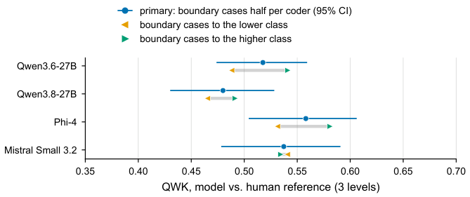
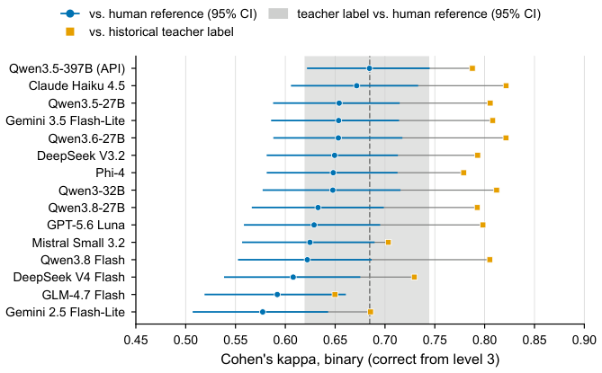

# A.6 Supplementary results for RQ3 and RQ4

[Appendix index](README.md)

[A.6.1 Partial credit and the independent human reference](06-human-reference.md#a61) · [A.6.2 Score-rationale consistency](06-human-reference.md#a62)

## A.6.1 Partial credit and the independent human reference

#### Agreement between the coders before adjudication.

We refer to the two coders as coder A (first author) and coder B (second author). Pooled over the 439 unique question–answer texts, their independent codings agree with a quadratic weighted kappa (QWK) of 0.681 \[0.616, 0.738\] on the five-level raw scale, where brackets give 95% percentile bootstrap intervals over texts. The two coders assign the same raw level to 49.2% of the texts and levels at most one apart to 83.8%. On the three-level analysis scale, the QWK is 0.639 \[0.568, 0.701\], the exact agreement 71.3%, and the unweighted Cohen’s kappa 0.511. A bootstrap over the nine questions instead of over texts widens the intervals to \[0.534, 0.807\] on the raw scale and \[0.552, 0.710\] on the three-level scale. Because the 39 texts of question r1q21 occur in 50 prediction rows, the model comparisons below use a slightly different base; on these 450 rows, the three-level coder agreement is 0.623 \[0.542, 0.695\], and only this value may be set beside the model values.

The two coders assign different raw levels to 223 of the 439 texts. Most of these disagreements are small: 152 are one level apart, 56 two levels, 12 three levels, and 3 four levels. Only 126 of the 223 disagreements change the three-level class. Of these, 102 lie at the boundary between partial and full credit (71 of them exactly between levels 3 and 4), 21 at the boundary between no credit and partial credit, and 3 between levels 0 and 4; the remaining 97 disagreements lie entirely within levels 1 to 3 and leave the three-level class unchanged. On the raw scale, coder B is more lenient than coder A: the mean level difference, coder A minus coder B, is $`-0.27`$ \[$`-0.37`$, $`-0.17`$\]. On the three-level scale, the mean difference shrinks to $`-0.03`$ \[$`-0.08`$, $`+0.02`$\], and its interval includes zero. The two coders thus use the scale differently mainly inside the partial-credit band, which the three-level analysis collapses.

Agreement varies strongly between questions. On the raw scale, the per-question QWK ranges from 0.322 for r1q15, which asks how to restore a deleted branch, to 0.849 for r1q21, which asks for the command that creates a tag; on the three-level scale, it ranges from 0.430 (r1q15) to 0.771 (r1q20). Two questions stand apart: r1q15 and r1q17, which asks for the sequence of commands to clone a repository, create a branch, commit, and push, reach raw QWK values of 0.322 and 0.446, while the other seven questions lie between 0.668 and 0.849. Together, the two questions account for 75 of the 223 raw disagreements (34%), but for 38 of the 71 disagreements of two or more levels and for 13 of the 15 disagreements of three or more levels. Their disagreements also have a consistent direction: coder B assigns the higher level in 35 of the 36 disagreements on r1q15 and in 37 of the 39 on r1q17. We read this as a calibration difference rather than as a series of individual slips: both questions ask for a multi-step procedure, and the coders differ in how many missing or imprecise steps an answer may contain and still count as essentially correct. This reading remains a hypothesis, because two other questions that ask for a procedure, r1q16 and r1q20, show high agreement. Calibration differences do not all point the same way: on r1q21, coder B is the stricter coder and assigns the higher level in only 9 of 21 disagreements, and 8 of the 10 disagreements that change the three-level class concern one question of interpretation, namely whether a lightweight tag fully answers the question or only an annotated tag does.

The joint adjudication resolved all 71 disagreements of two or more levels. In 18 of these cases, the adjudicated level equals coder A’s level, in 17 coder B’s level, and in 36 a level between the two, so neither coder dominates the adjudicated decisions. The three-level reference thus consists of 216 texts on which the coders agreed, 71 adjudicated texts, 75 texts with residual dissent inside levels 1 to 3, which receive the partial-credit class from both coders, and 77 texts with residual dissent across a class boundary (71 between levels 3 and 4, 6 between levels 0 and 1). In the primary comparison, each boundary text enters with weight one half for each coder’s class; resolving all 77 to the lower class (strict), to the higher class (lenient), or excluding them serves as sensitivity analysis (Section 4.2).

**Figure A.3.** Agreement of the four partial-credit graders with the independent human reference. Quadratic weighted kappa (three levels) between each model’s level and the reference over the 450 prediction rows (439 texts, nine questions). The reference takes the common level where both coders agree (216 texts) and the jointly adjudicated level where they differ by two or more levels (71); adjacent disagreements are retained as residual dissent and enter with their common three-level class (75) or, at a class boundary, with weight one half for each coder’s class (77). Circles and whiskers: this primary reference with 95% percentile bootstrap intervals over texts (10,000 resamples). Triangles: all 77 boundary cases resolved to the lower or to the higher class (point estimates). One run per model at 40 in-context examples, temperature 0.2.

[Vector PDF](figures/fig10_model_vs_reference.pdf)

#### Partial-credit grades against the reference.

Four models, Phi-4, Mistral Small 3.2, Qwen3.6-27B, and Qwen3.8-27B, graded the pool with the partial-credit prompt, which asks for a level of 0, 1, or 2 in addition to the binary decision (Section 4.4). Figure [A.3](06-human-reference.md#figure-a3) shows their agreement with the three-level reference at 40 in-context examples and temperature 0.2. Against the primary reference, Phi-4 reaches a QWK of 0.558 \[0.504, 0.606\], Mistral Small 3.2 0.537 \[0.478, 0.591\], Qwen3.6-27B 0.518 \[0.474, 0.559\], and Qwen3.8-27B 0.480 \[0.430, 0.528\]. The exact three-level agreement lies between 46.2% (both Qwen models) and 57.6% (Mistral Small 3.2). Agreement is thus moderate for all four models. Phi-4 has the highest and Qwen3.8-27B the lowest point estimate, but the intervals overlap broadly, and since paired differences were not computed, the data do not establish a ranking.

How the 77 boundary texts are resolved changes the values by at most 0.03 relative to the primary reference. The span between the strict and the lenient resolution is at most 0.053 (Qwen3.6-27B) and stays below the width of every interval, which ranges from 0.085 to 0.113. The lenient resolution yields higher QWK for Phi-4 (strict 0.531, lenient 0.581) and Qwen3.6-27B (0.488, 0.541); this difference does not directly describe how frequently either model awards full credit to boundary texts. Exact agreement, which counts matching classes only, does not rise with it: it is 52.2% under the strict and 52.0% under the lenient resolution for Phi-4, and 48.0% and 44.4% for Qwen3.6-27B, because QWK also depends on the marginal distribution of the three classes. Mistral Small 3.2 is almost insensitive to the resolution (0.541 versus 0.535) and would lie marginally ahead of Phi-4 under the strict resolution, whereas Qwen3.8-27B (0.465, 0.491) has the lowest value under every resolution. Excluding the boundary texts, which leaves 364 rows (362 texts), raises all four values to between 0.501 and 0.584. This exclusion, however, also changes the evaluated sample and its class distribution; the increase alone does not establish that boundary texts are harder for the models, and it is no reason to drop them from the primary comparison.

Two observations place these values, but neither supplies a clean ceiling. First, before adjudication, all four models agreed more closely with coder A (QWK between 0.532 and 0.577) than with coder B (between 0.365 and 0.523); the adjudicated reference, and with it the model values, lies between the two coders. Coder A’s codings are also closer to the historical teacher label (Cohen’s kappa 0.749 for coder A and 0.508 for coder B, binarized as correct from level 3), so one plausible but untested explanation is that the in-context examples, which carry the binary teacher label, pull the models toward coder A’s scale. Second, the coders agree with each other at a three-level QWK of 0.623 on the same 450 rows, and all four model point estimates lie below this value. The comparison is not a ceiling comparison, however: the reference combines both codings and therefore lies closer to each coder than the coders lie to each other. Moreover, the comparison with coder agreement depends on the mapping of the raw scale. Under a sensitivity mapping that counts raw level 1 as no credit, coder agreement falls to 0.595 \[0.525, 0.660\] on the 439 texts and to 0.585 on the 450 rows, whereas the four models’ agreement with coder A rises to between 0.588 and 0.671 on the same rows. The declared mapping remains the primary analysis, because switching it after seeing the data would be a forking path, and we report the sensitivity mapping next to it.

#### Binary grades against the binarized reference.

Apart from the four partial-credit runs, every grading condition of this study produces only a binary decision, and so far these decisions have been compared only with the historical teacher label. The third step therefore compares the binary base arm of each of the fifteen models with the reference, binarized as correct from raw level 3. The fifteen arms comprise the five ICWE models in the replication arms of Section 5.1, four current hosted models of the same price class (three vendor successors of ICWE models and one model from a vendor absent from the ICWE set), and six open-weight models served on premises. All fifteen base arms use the base grading condition with 40 in-context examples on the 450 prediction rows; for the four open-weight runs of 17 August 2026, the prompt hash was not recorded (Section 4.4). Temperature 0.2 was requested for all fifteen; GPT-5.6 Luna discarded this setting, because none of its endpoints supports it, and ran at its default temperature. Gemini 3.5 Flash-Lite rejects disabled reasoning and was run with the minimal reasoning setting instead, so its arm, like that of GPT-5.6 Luna, is not settings-identical with the other hosted arms. The threshold was justified before this comparison by the relation of the raw levels to the historical teacher label (Section 4.2), and level 4 serves as stricter sensitivity threshold. Residual dissent that straddles the threshold counts half for each side, which concerns the 55 texts with levels 2 and 3 at the primary threshold and the 71 texts with levels 3 and 4 at the stricter one. We report Cohen’s kappa with 95% percentile bootstrap intervals over texts (2,000 resamples). This comparison was not part of the analysis plan; it was added after the reference was complete, and its results are post hoc and exploratory.

The comparison reads each run’s stored binary outcome as it is, including technical fallback values. In three of the 51 arms, nine output rows contain no parseable decision, and the pipeline stored the fallback score 0 for them, which this comparison counts as a decision of incorrect. Six of these rows are failed requests of Qwen3.8 Flash, one of the fifteen base arms; two are outputs of Qwen3.8-27B under the deconfounding prompt with the confidence clause alone that were cut off at the output length limit, and one is the Phi-4 output of the rationale condition without a parseable score (Section 5.4). For these three runs, the kappa values therefore describe the agreement of the stored pipeline outcomes, not of model decisions alone. The agreement rates of RQ1 of the article, in contrast, count parseable rows only; for Qwen3.8 Flash, these are 402 agreeing rows among 444 parseable ones. We did not recompute the binary comparison on parseable rows only.

### Table A.11: Binary arms against the human reference and teacher label

| Model | Reference $`\geq 3`$ \[95% CI\] | Teacher label | Reference $`\geq 4`$ |
| --- | --- | --- | --- |
| *ICWE models, hosted API (replication arms)* |  |  |  |
| Qwen3.5-397B-A17B | 0.684 \[0.622, 0.745\] | 0.788 | 0.536 |
| Claude Haiku 4.5 | 0.672 \[0.606, 0.733\] | 0.822 | 0.507 |
| DeepSeek V3.2 | 0.649 \[0.581, 0.713\] | 0.793 | 0.463 |
| GLM-4.7 Flash | 0.592 \[0.519, 0.661\] | 0.650 | 0.438 |
| Gemini 2.5 Flash-Lite | 0.577 \[0.507, 0.643\] | 0.686 | 0.570 |
| *Current models of the same price class, hosted API* |  |  |  |
| Gemini 3.5 Flash-Lite$`^{\dagger}`$ | 0.653 \[0.586, 0.714\] | 0.808 | 0.504 |
| GPT-5.6 Luna$`^{\ast}`$ | 0.629 \[0.558, 0.695\] | 0.798 | 0.479 |
| Qwen3.8 Flash$`^{\ddagger}`$ | 0.622 \[0.552, 0.687\] | 0.805 | 0.501 |
| DeepSeek V4 Flash | 0.608 \[0.539, 0.675\] | 0.729 | 0.486 |
| *Open-weight models, served on premises* |  |  |  |
| Qwen3.5-27B | 0.654 \[0.588, 0.715\] | 0.806 | 0.539 |
| Qwen3.6-27B | 0.653 \[0.588, 0.717\] | 0.821 | 0.518 |
| Phi-4 | 0.648 \[0.581, 0.713\] | 0.779 | 0.458 |
| Qwen3-32B | 0.648 \[0.577, 0.716\] | 0.812 | 0.494 |
| Qwen3.8-27B | 0.633 \[0.566, 0.699\] | 0.793 | 0.532 |
| Mistral Small 3.2 | 0.625 \[0.557, 0.690\] | 0.703 | 0.351 |
| Historical teacher label | 0.685 \[0.619, 0.744\] | n/a | 0.479 |

Post hoc exploratory comparison of the fifteen binary base arms with the binarized human reference and with the historical teacher label. Cohen’s kappa over 450 prediction rows (439 texts), one run per model at 40 in-context examples, temperature 0.2 requested. Reference $`\geq 3`$: correct from raw level 3 (primary), with 95% percentile bootstrap interval over texts (2,000 resamples); reference $`\geq 4`$: correct from raw level 4 (sensitivity, point estimate). Residual dissent that straddles a threshold counts half for each side. The last row compares the historical teacher label itself with the reference. Values describe the stored pipeline outcomes. $`^{\ast}`$Temperature setting discarded by the model’s endpoints; run at the model’s default temperature. $`^{\dagger}`$Run with the minimal instead of the disabled reasoning setting, which the model rejects. $`^{\ddagger}`$Includes six failed requests stored with the fallback score 0 and counted as incorrect in both comparisons.

[Download CSV](tables/table-a11.csv)

**Figure A.4.** Agreement of the fifteen binary base arms with the binarized human reference and with the historical teacher label (post hoc exploratory). Cohen’s kappa of each arm’s stored binary outcome (one base arm per model, 40 in-context examples, temperature 0.2 requested, 450 prediction rows of 439 texts; GPT-5.6 Luna ran at its default temperature, Gemini 3.5 Flash-Lite with the minimal reasoning setting) against the human reference made binary (correct from raw level 3; adjacent disagreements that straddle the threshold count half for each side) and against the historical teacher label. Grey band and dashed line: the historical teacher label against the human reference. Whiskers: 95% percentile bootstrap intervals over texts (2,000 resamples). For Qwen3.8 Flash, both values include six failed requests stored with the fallback score 0 and counted as incorrect. “Qwen3.5-397B (API)” denotes Qwen3.5-397B-A17B.

[Vector PDF](figures/fig11_binary_runs_vs_reference.pdf)

Table [A.11](06-human-reference.md#table-a11) and Figure [A.4](06-human-reference.md#figure-a4) show the result. Against the binarized reference, the fifteen base arms reach kappa values between 0.577 (Gemini 2.5 Flash-Lite) and 0.684 (Qwen3.5-397B-A17B); against the historical teacher label, the same arms reach between 0.650 and 0.822. Every arm agrees less with the reference than with the teacher label, by 0.06 to 0.18 kappa points. The gap is not specific to the base arms: it is negative in all 51 non-diagnostic arms of the study’s run selection, which include the guided, rationale, partial-credit, repeat, and temperature-0 arms, and it ranges from $`-0.183`$ to $`-0.058`$ across them. The historical teacher label itself agrees with the reference at a kappa of only 0.685 \[0.619, 0.744\]. This value marks what a grader that reproduced the teacher label exactly would reach against the reference. The highest point estimates, Qwen3.5-397B-A17B (0.684) and Claude Haiku 4.5 (0.672), come close to this value, and the intervals of all fifteen arms overlap the interval of the teacher label. Measured against the independent reference, the highest model point estimates are thus close to the operational label’s agreement with that reference, and none exceeds its point estimate, neither among the fifteen base arms nor among all 51 arms. Equivalence has not been established: overlapping marginal intervals do not show that two agreements are equal.

To compare each arm directly with the teacher label, we computed, post hoc and exploratorily, the difference between the arm’s kappa against the reference and the teacher label’s kappa against the same reference on the same 450 rows. Both kappas are computed on the same bootstrap resamples of unique texts (10,000 resamples, seed 42), so the interval of the difference takes into account that the two kappas move together; their correlation over the resamples lies between 0.49 and 0.76 for the base arms at the primary threshold. Table [A.12](06-human-reference.md#table-a12) lists the differences at both thresholds.

Correct from level 3, no difference lies above zero, and six of the fifteen intervals lie entirely below zero; the other nine include zero, which, without an equivalence margin, does not show that these arms agree with the reference as well as the teacher label does. The pairing matters: Gemini 2.5 Flash-Lite reaches 0.577 \[0.507, 0.643\] against the reference, an interval that overlaps that of the teacher label, yet its paired difference of $`-0.107`$ \[$`-0.167`$, $`-0.050`$\] excludes zero.

Correct from level 4, the teacher label agrees with the reference at only 0.479, and four arms lie above it with intervals that exclude zero, while Mistral Small 3.2 lies below it; Gemini 2.5 Flash-Lite, last at level 3, is first at level 4. The per-arm intervals are not adjusted for multiplicity; after a Holm adjustment within the fifteen base arms, only Gemini 2.5 Flash-Lite stays below 0.05 at level 3, and Mistral Small 3.2 and Gemini 2.5 Flash-Lite at level 4. Over all 51 arms, no difference lies above zero at level 3, and 32 of the 51 intervals lie entirely below zero.

### Table A.12: Paired model-versus-label differences

|  | Reference $`\geq 3`$ |  | Reference $`\geq 4`$ |  |
| --- | --- | --- | --- | --- |
| Model | $`\Delta`$ \[95% CI\] | $`p_{\mathrm{Holm}}`$ | $`\Delta`$ \[95% CI\] | $`p_{\mathrm{Holm}}`$ |
| *ICWE models, hosted API (replication arms)* |  |  |  |  |
| Qwen3.5-397B-A17B | $`-0.000`$ \[$`-0.049`$, $`+0.048`$\] | 1.000 | $`+0.057`$ \[$`+0.010`$, $`+0.105`$\] | 0.218 |
| Claude Haiku 4.5 | $`-0.013`$ \[$`-0.060`$, $`+0.033`$\] | 1.000 | $`+0.028`$ \[$`-0.016`$, $`+0.071`$\] | 1.000 |
| DeepSeek V3.2 | $`-0.035`$ \[$`-0.087`$, $`+0.015`$\] | 1.000 | $`-0.016`$ \[$`-0.060`$, $`+0.029`$\] | 1.000 |
| GLM-4.7 Flash | $`-0.093`$ \[$`-0.161`$, $`-0.027`$\] | 0.053 | $`-0.041`$ \[$`-0.103`$, $`+0.020`$\] | 1.000 |
| Gemini 2.5 Flash-Lite | $`-0.107`$ \[$`-0.167`$, $`-0.050`$\] | 0.012 | $`+0.091`$ \[$`+0.034`$, $`+0.147`$\] | 0.022 |
| *Current models of the same price class, hosted API* |  |  |  |  |
| Gemini 3.5 Flash-Lite$`^{\dagger}`$ | $`-0.031`$ \[$`-0.083`$, $`+0.019`$\] | 1.000 | $`+0.025`$ \[$`-0.018`$, $`+0.068`$\] | 1.000 |
| GPT-5.6 Luna$`^{\ast}`$ | $`-0.056`$ \[$`-0.108`$, $`-0.006`$\] | 0.306 | $`+0.000`$ \[$`-0.044`$, $`+0.044`$\] | 1.000 |
| Qwen3.8 Flash$`^{\ddagger}`$ | $`-0.063`$ \[$`-0.112`$, $`-0.014`$\] | 0.132 | $`+0.023`$ \[$`-0.021`$, $`+0.065`$\] | 1.000 |
| DeepSeek V4 Flash | $`-0.077`$ \[$`-0.135`$, $`-0.019`$\] | 0.130 | $`+0.007`$ \[$`-0.046`$, $`+0.059`$\] | 1.000 |
| *Open-weight models, served on premises* |  |  |  |  |
| Qwen3.5-27B | $`-0.031`$ \[$`-0.077`$, $`+0.015`$\] | 1.000 | $`+0.060`$ \[$`+0.019`$, $`+0.104`$\] | 0.078 |
| Qwen3.6-27B | $`-0.031`$ \[$`-0.075`$, $`+0.011`$\] | 1.000 | $`+0.039`$ \[$`-0.001`$, $`+0.080`$\] | 0.600 |
| Phi-4 | $`-0.037`$ \[$`-0.091`$, $`+0.018`$\] | 1.000 | $`-0.021`$ \[$`-0.068`$, $`+0.026`$\] | 1.000 |
| Qwen3-32B | $`-0.037`$ \[$`-0.087`$, $`+0.011`$\] | 1.000 | $`+0.015`$ \[$`-0.026`$, $`+0.057`$\] | 1.000 |
| Qwen3.8-27B | $`-0.052`$ \[$`-0.100`$, $`-0.006`$\] | 0.301 | $`+0.053`$ \[$`+0.010`$, $`+0.098`$\] | 0.218 |
| Mistral Small 3.2 | $`-0.060`$ \[$`-0.123`$, $`+0.002`$\] | 0.533 | $`-0.128`$ \[$`-0.178`$, $`-0.079`$\] | 0.003 |

Post hoc exploratory paired comparison of each binary base arm with the historical teacher label at the binarized human reference. $`\Delta`$: the arm’s Cohen’s kappa against the reference minus the teacher label’s kappa against the same reference (0.685 correct from raw level 3, 0.479 correct from raw level 4), on the same 450 prediction rows (439 texts); one run per model at 40 in-context examples, temperature 0.2 requested. Brackets: 95% paired percentile bootstrap interval over unique texts, with the same 10,000 resamples (seed 42) for the arm and the label. $`p_{\mathrm{Holm}}`$: two-sided bootstrap p-value, Holm-adjusted within the fifteen base arms of a threshold (supplementary). No equivalence margin was set; an interval that includes zero does not show equal agreement. Values describe the stored pipeline outcomes; markers as in Table [A.11](06-human-reference.md#table-a11). For Qwen3.8 Flash, excluding the six failed requests for arm and label alike gives $`-0.055`$ \[$`-0.104`$, $`-0.007`$\] at level 3 and $`+0.033`$ \[$`-0.007`$, $`+0.073`$\] at level 4.

[Download CSV](tables/table-a12.csv)

The spread between the arms is narrow and their intervals overlap, so the data do not establish a ranking. The ranking against the reference is also only moderately related to the ranking against the teacher label (Spearman correlation 0.66). The threshold matters for the ranking as well. Correct from level 4, all values drop, to between 0.351 and 0.570, and the order changes substantially (Spearman correlation 0.35 between the two thresholds): Gemini 2.5 Flash-Lite, last at the primary threshold, becomes first, and Mistral Small 3.2 falls to last place. These ranking changes are consistent with differences in grading strictness. Correct from level 3, the reference counts 58.6% of the rows as correct (the teacher label 56.0%), and correct from level 4 only 33.1%, whereas the arms mark between 42.7% (Gemini 2.5 Flash-Lite) and 67.1% (Mistral Small 3.2) of the rows as correct. The strictest arm, Gemini 2.5 Flash-Lite, rises in relative rank at the stricter threshold and the most lenient arm, Mistral Small 3.2, falls, although the kappa of every arm decreases. Strictness does not account for the order on its own, however: Qwen3.5-397B-A17B, which marks 48.0% of the rows as correct and is thus among the stricter arms, falls from first to third place.

To check whether the gap between the two references is an artifact of the threshold, we computed the comparison for all four possible thresholds. Averaged over the fifteen arms, kappa against the reference is 0.26 correct from level 1, 0.43 from level 2, 0.64 from level 3, and 0.49 from level 4; the historical teacher label reaches 0.29, 0.49, 0.685, and 0.48. Every one of the fifteen models and the teacher label agree best with the reference at level 3, and at no threshold does any of the 51 arms agree more with the reference than with the teacher label. The lower agreement with the independent reference thus persists across all four thresholds, although the magnitude of the gap changes: over the 51 arms, it lies between $`-0.58`$ and $`-0.22`$ at level 1 and between $`-0.36`$ and $`-0.04`$ at level 4. The primary threshold was justified before this comparison and is not fitted to the models.

Two further values help to read these results. Binarized at level 3, the two independent codings agree with each other at a kappa of only 0.477 \[0.397, 0.558\], because many of their disagreements fall exactly at the boundary between levels 2 and 3; since the reference combines both codings, this value is no ceiling for the models. For the four open-weight models that were run under all prompt variants, the base arms (kappa 0.625 to 0.653 against the reference) are among the best conditions: the guided prompts reach 0.472 to 0.617 and the rationale prompts 0.532 to 0.610, while the binary decisions of the partial-credit runs reach 0.632 to 0.669.

## A.6.2 Score-rationale consistency

RQ4 of the article asks whether the judgment that a grader expresses in its rationale agrees with the score that the same grader records in the same output. The audit uses the rationale condition of the four open-weight graders Qwen3.6-27B, Qwen3.8-27B, Phi-4, and Mistral Small 3.2 at 40 in-context examples and temperature 0.2, with 450 output rows per grader and 1,800 rows in total, containing 1,799 nonempty rationales. Its reference is the recorded score, not a human judgment: the audit measures internal consistency only and says nothing about whether a rationale or a score is correct. We did not compare the rationales with human feedback; lecturer comments were available for only 71 of the 7,491 source rows, including 60 evaluated texts, which is not a reference for the whole pool. Because the rationale condition was added after the analysis plan was fixed, all results in this subsection are exploratory. Four score-blind instruments read the rationales (Section 4.3): the frozen lexicon rule, its sensitivity variant, which resolves rationales that match both cue lists by their last contrastive clause, and two LLM judges, the Gemma judge and the Qwen judge, with an identical frozen prompt. One Phi-4 output contains neither a rationale nor a parseable score; it remains in the denominator as missing input and counts neither as consistent nor as contradictory.

Table [A.14](06-human-reference.md#table-a14) reproduces the article’s score-rationale table and reports, for each instrument, the contradictions among the rationales that it could decide and whose recorded score was parseable. The instruments differ first in coverage. The lexicon rule decides between 320 and 370 of the 450 rows per grader (71% to 82%), because it abstains whenever cues from both predefined lists match and leaves rationales without any cue undecided; its sensitivity variant decides between 365 and 421. The Gemma judge decides between 434 and 450 rationales per grader and abstains on 24 rationales in total, while the Qwen judge decides between 393 and 449 and abstains on 105.

### Table A.14: Score-rationale contradictions and comparable-case denominators

| Grader | Lexicon rule | Sensitivity variant | Gemma judge | Qwen judge |
| --- | --- | --- | --- | --- |
| Mistral Small 3.2 | 0/370 | 39/421 | 3/434 | 2/405 |
| Phi-4 | 2/339 | 40/407 | 24/441 | 4/393 |
| Qwen3.6-27B | 0/343 | 14/387 | 0/450 | 0/447 |
| Qwen3.8-27B | 4/320 | 18/365 | 0/450 | 0/449 |

Exploratory score-rationale audit: contradictions / comparable rationales, where comparable means decided by the instrument with a parseable recorded score. There are 450 input rows per grader (one Phi-4 row without a rationale), 40 in-context examples and temperature 0.2. No human reference is involved. Instrument coverage differs, so these columns do not establish a ranking. Values reproduce the accompanying article’s score-rationale table (`tab:c2`, Table 7 in the 16 October 2026 revision).

[Download CSV](tables/table-a14.csv)

The lexicon rule finds between zero and four contradictions per grader, at most 4 of 320 decided rationales for Qwen3.8-27B. The sensitivity variant finds between 14 and 40 contradictions per grader. The Gemma judge finds no contradiction for the two Qwen graders, 24 among 441 comparable rationales for Phi-4 (5.44%), and 3 among 434 for Mistral Small 3.2 (0.69%); the Qwen judge finds none for the two Qwen graders, 4 among 393 for Phi-4, and 2 among 405 for Mistral Small 3.2.

Because the instruments decide different rationales, a direct comparison must use the rationales that both instruments decide (R3). The two judges both decide 1,691 rationales and assign the same category to 1,688 of them; only three receive opposite categories, and 87 of the 90 rationales on which the judges’ categories differ at all are cases in which one judge abstains. On this common subset, the Gemma judge finds six contradictions and the Qwen judge five. The larger total of the Gemma judge (27 against 6 contradictions) therefore mainly reflects different coverage: 21 of the rationales that the Gemma judge marks as contradictory are rationales on which the Qwen judge abstains, whereas only one of the Qwen judge’s contradictions lies outside the common subset. The sensitivity variant and the Gemma judge, in contrast, disagree even on the rationales that both decide. On these shared rationales, the sensitivity variant marks 106 rationales as contradictory and the Gemma judge 26, but only 4 rationales are marked by both; for Phi-4, the Gemma judge marks 20 rationales that the sensitivity variant does not.

The lexicon rule abstains when both predefined cue lists match. Semantically mixed rationales, which name both strengths and defects of an answer, can still receive a decisive classification when a cue is missed: five of the six contradictions that the lexicon rule finds are hedged rationales of this kind, four of them German rationales of Qwen3.8-27B that call the answer correct but note an omission whose wording is absent from the defect list, and only one is an unhedged contradiction. The sensitivity variant resolves the matched mixed cases through the last contrastive clause, and the judges read an overall judgment or abstain. The low count of the lexicon rule is therefore partly an effect of its abstention. A reading of a stratified sample of 160 rationales (40 per grader, enriched with mixed rationales) by the LLM agent that had implemented the lexicon, blinded to the source model, the recorded score, and the answer text but aware of the study’s purpose, was carried out to check the lexicon rule rather than as a result. It found 25 contradictions where the lexicon rule found 6, and the two readings agree with a three-class Cohen’s kappa of 0.433. This reader is not independent of the instrument, and because of the stratification, these counts permit no estimate for all available rationales in the 1,800-row input set. Neither judge finds a contradiction among the decided rationales of the two Qwen graders, and the contradictions that the judges find concentrate in the rationales of Phi-4 and Mistral Small 3.2. This agreement has a caveat: the Qwen judge has the same declared model designation, Qwen/Qwen3.8-27B, as one grader and belongs to the family of another; the weight revision was not pinned, and no instrument has been validated against a human reading of the rationales.
